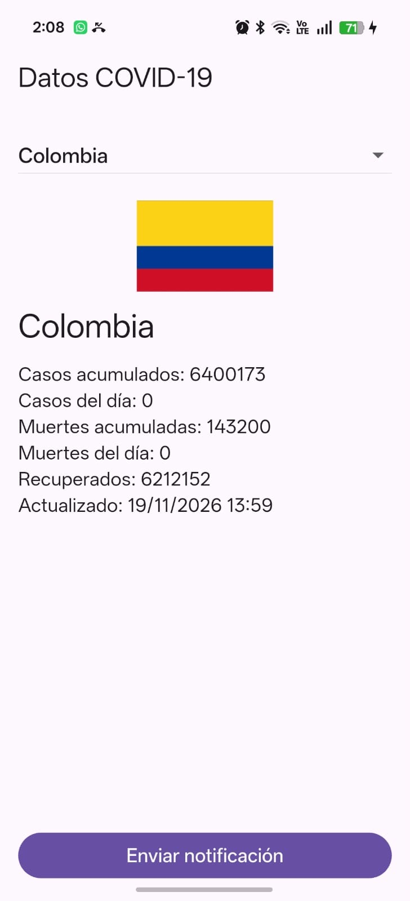
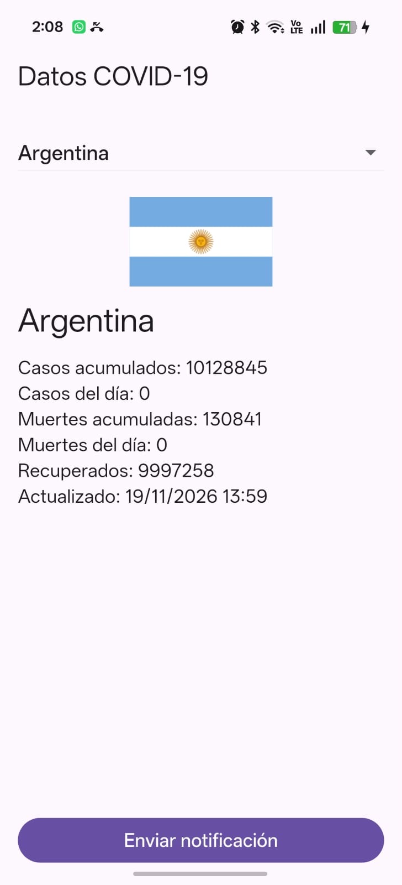
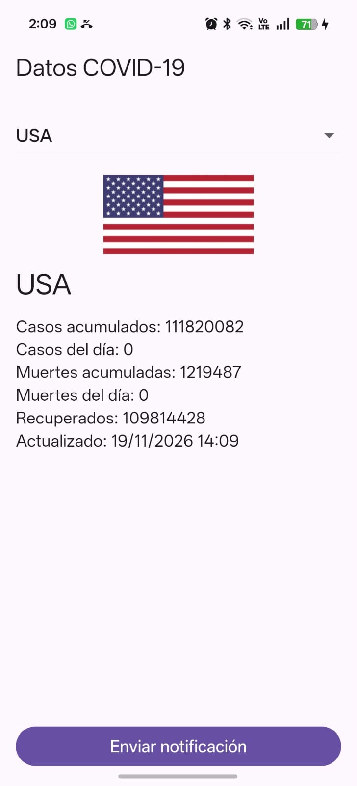
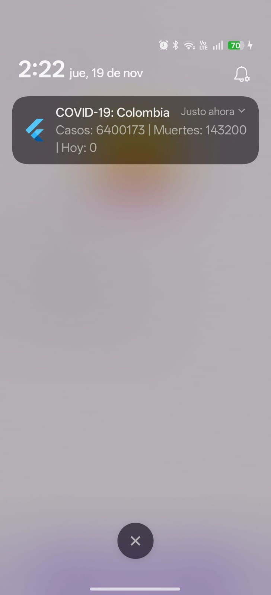
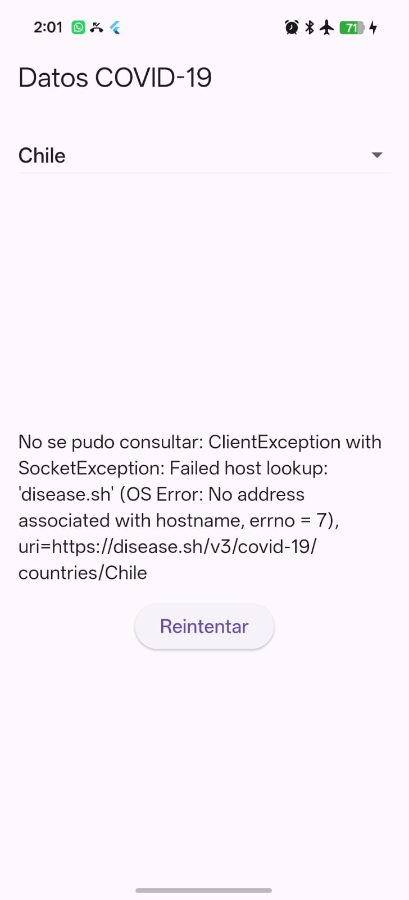

# covid_notify

Taller de Flutter de la clase de Móviles.

Hanna Gabriela Castaño Beltrán

## Qué hace la app

Es una app para Android que consulta la API de COVID-19 de disease.sh. Se escoge un país en la lista y la app muestra los casos, las muertes, los recuperados y la fecha de actualización de ese país. Con el botón "Enviar notificación" llega una notificación al celular con el resumen de los datos.

Si no hay internet, sale un mensaje de error con un botón para reintentar.

Como ampliación agregué la bandera de cada país usando `Image.network`.

## Archivos

- `main.dart`: la pantalla de la app.
- `covid_data.dart`: el modelo de los datos.
- `covid_api.dart`: la consulta a la API.
- `notification_service.dart`: las notificaciones.

## Cómo correrla

1. Clonar el repositorio.
2. Ejecutar `flutter pub get`.
3. Conectar un celular Android o abrir un emulador.
4. Ejecutar `flutter run`.
5. Aceptar el permiso de notificaciones cuando la app lo pida.

## Evidencias

Datos de Colombia:

Cambiando de país:

 

Notificación:

Error sin internet (modo avión):

